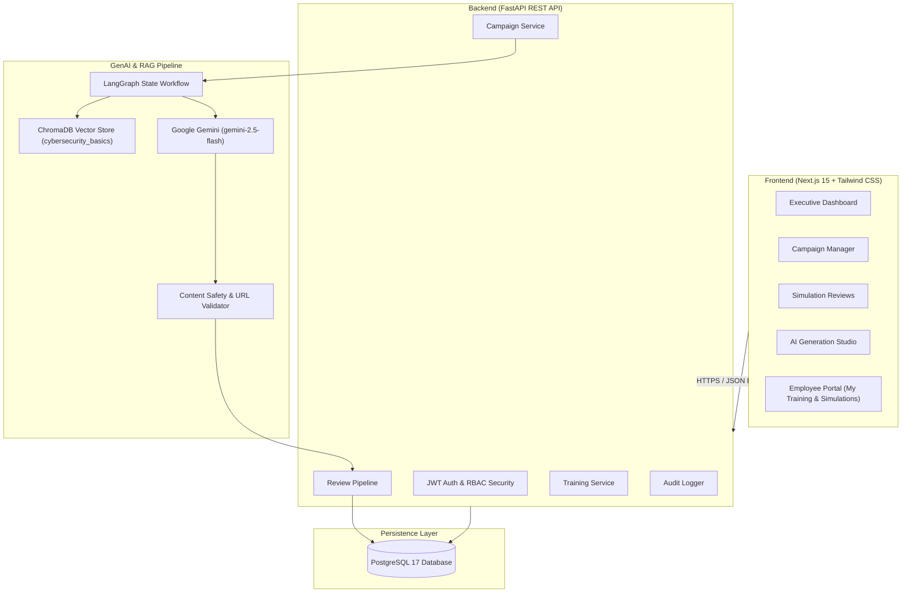
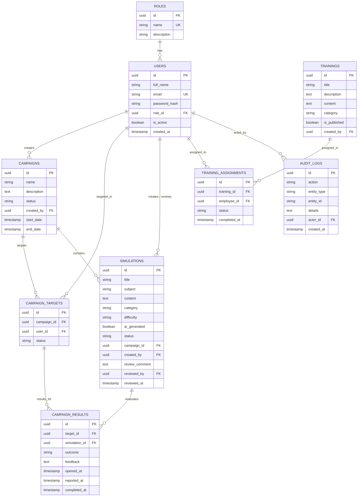

# AI-Powered Phishing Simulation & Security Awareness Platform

[](https://www.python.org/)
[](https://fastapi.tiangolo.com/)
[](https://nextjs.org/)
[](https://www.postgresql.org/)
[](https://www.trychroma.com/)
[](LICENSE)

An end-to-end cybersecurity training and simulation system designed to educate employees on phishing threats and assess organizational vulnerability using generative AI and Retrieval-Augmented Generation (RAG).

Developed as part of the **Semester 3 On-the-Job Training (OJT) Project**.

---

## 🌟 Key Features

- **Generative AI Simulation**: Grounded phishing scenario generation powered by Google Gemini and ChromaDB vector retrieval (RAG).
- **Targeted Security Campaigns**: Create campaigns, assign employee targets, and track interaction status (assigned, opened, reported, completed).
- **Human-in-the-Loop Review Pipeline**: Safety and review interface for Security Analysts and Admins to inspect, approve, or reject simulations with mandatory feedback.
- **Interactive Security Training**: Assign awareness modules to employees based on simulation outcomes with progress tracking.
- **Role-Based Access Control (RBAC)**: Enforced across `Admin`, `Campaign Manager`, `Security Analyst`, `Auditor`, and `Employee`.
- **Immutable Audit Logging**: Comprehensive audit trail capturing user actions, simulation reviews, and employee activity.
- **Modern Dashboard UI**: Built with Next.js 15 App Router, Tailwind CSS, responsive layouts, and interactive status tabs.

---

## 🏗️ System Architecture



---

## 🗄️ Database Entity-Relationship (ER) Diagram



---

## 🔐 Role-Based Access Control (RBAC) Matrix

| Endpoint Group | Admin | Campaign Manager | Security Analyst | Auditor | Employee |
| :--- | :---: | :---: | :---: | :---: | :---: |
| **User Management** (`/api/admin/users`) | ✅ | ❌ | ❌ | ❌ | ❌ |
| **Campaign Creation** (`/api/campaigns`) | ✅ | ✅ | ❌ | ❌ | ❌ |
| **AI Simulation Generation** (`/api/ai/generate-simulation`) | ✅ | ✅ | ❌ | ❌ | ❌ |
| **Review & Approve/Reject** (`/api/reviews`) | ✅ | ✅ | ✅ | ❌ | ❌ |
| **Training Catalog Management** (`/api/trainings`) | ✅ | ✅ | ❌ | ❌ | ❌ |
| **Dashboard Analytics** (`/api/dashboard/*`) | ✅ | ✅ | ✅ | ✅ | ❌ |
| **Audit Logs** (`/api/admin/audit-logs`) | ✅ | ❌ | ❌ | ✅ | ❌ |
| **Employee Portal** (`/api/simulations/my`, `/trainings/my`) | ❌ | ❌ | ❌ | ❌ | ✅ |

---

## 🚀 Getting Started

### Prerequisites

- Python 3.11+
- Node.js 18+ and npm
- Docker & Docker Compose (for PostgreSQL)

### 1. Database Setup

Start PostgreSQL using Docker Compose:

```bash
docker-compose up -d
```

### 2. Backend Setup

```bash
cd backend
python -m venv .venv
source .venv/bin/activate  # On Windows: .venv\Scripts\activate
pip install -r requirements.txt
cp .env.example .env
```

Configure your environment variables in `.env` (Gemini API key, PostgreSQL URL, JWT secret).

Initialize database tables and create the initial administrator:

```bash
python create_admin.py
uvicorn main:app --reload --port 8000
```

*Interactive API Docs*: `http://localhost:8000/docs`

### 3. Frontend Setup

```bash
cd frontend
npm install
npm run dev
```

*Web Application*: `http://localhost:3000`

---

## 🧪 Automated Roadmap Verification Suite

The repository includes a comprehensive end-to-end regression test suite covering all 8 project roadmap areas:

```bash
cd backend
python test_roadmap_suite.py
```

### Verified Roadmap Items
1. ✅ JWT Authentication & Password Hashing
2. ✅ Multi-Role RBAC Authorization (Admin, Campaign Manager, Security Analyst, Employee)
3. ✅ Campaign Creation, Editing, and Target Assignment
4. ✅ LangGraph Multi-Agent RAG Pipeline with ChromaDB & Google Gemini
5. ✅ Content Safety & Credential Harvesting Prevention
6. ✅ Human-in-the-Loop Review Pipeline (Approve, Reject with Comments, Status Queries)
7. ✅ Employee Interaction Lifecycle (Assigned, Opened, Reported, Completed)
8. ✅ Training Creation, Publishing, Assignment, and Completion
9. ✅ Platform Overview, Campaign Analytics, and Training Analytics
10. ✅ Immutable System Audit Trail

---

## 🛡️ Responsible Disclosure Note

This platform is strictly designed for educational, organizational training, and research purposes. All generated simulations enforce fictional pretexts, safe placeholders (`[SIMULATED TRAINING LINK - DO NOT OPEN]`), and strict credential-collection prevention.
